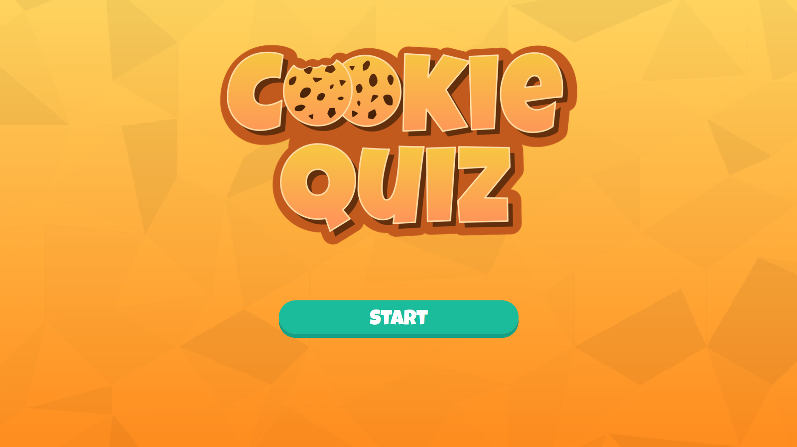
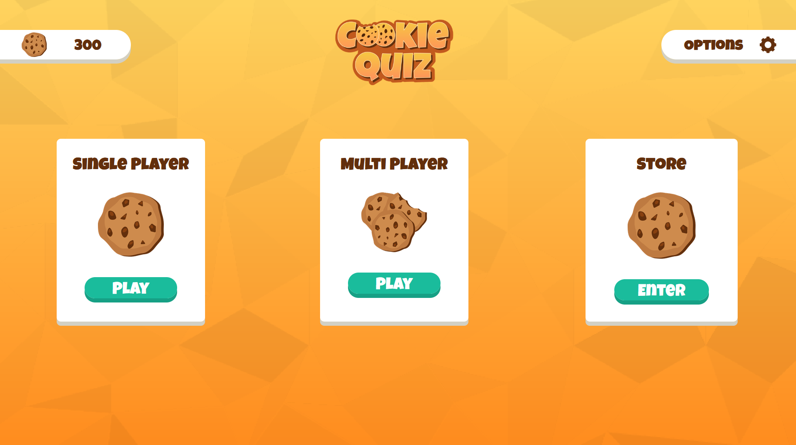
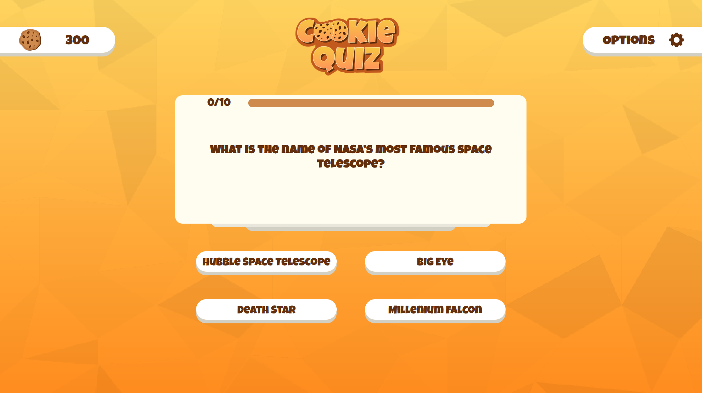
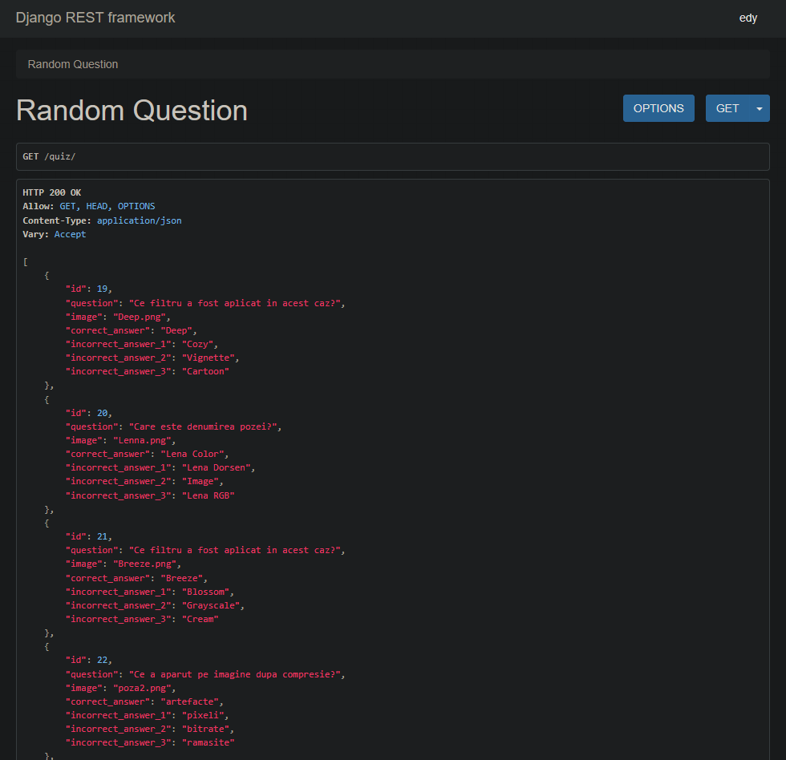
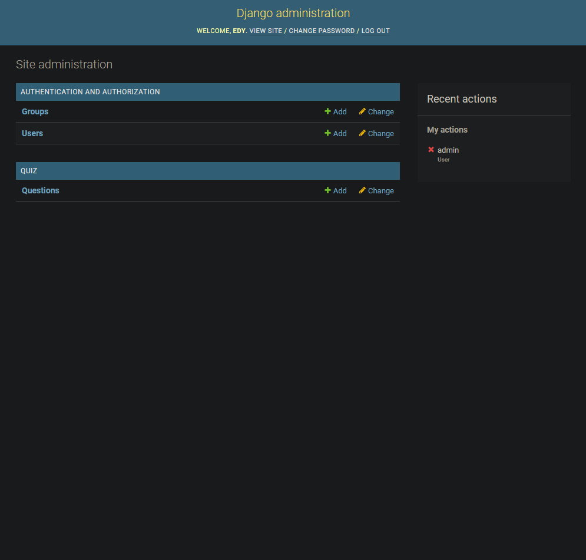

# CookieQuiz

Full-stack trivia application with a React frontend and a Django REST API backend.

CookieQuiz is a trivia game prototype built with React that fetches random 10-question quizzes across varied topics. Each question offers four answer choices, and the player selects the correct option.

The project was created in 2021 for a university assignment.

## Repository Structure

```text
CookieQuiz/
├── backend/       # Django REST API, SQLite database, and image assets
├── frontend/      # React application
├── screenshots/   # Screenshots with the app
└── README.md      # Root overview and quick start guide
```


## Features

- The frontend (`http://localhost:3000`) requests quiz questions from backend (`http://127.0.0.1:8000/quiz/`).
- Question images are served by Django from `http://127.0.0.1:8000/images/<path>`.
- Generates 10 random multiple-choice trivia questions per round, each with four answer options.
- If the Django backend is unavailable or returns no questions, the frontend falls back to the Open Trivia Database (`https://opentdb.com/`) via `https://opentdb.com/api.php?amount=10&type=multiple`.


## Running Locally

- Backend details: [backend/README.md](./backend/README.md)
- Frontend details: [frontend/README.md](./frontend/README.md)

Run the backend and frontend in two separate terminals.

1. Backend - Django

```bash
cd backend
python -m venv .venv
.venv\Scripts\activate
pip install -r requirements.txt
python manage.py migrate
python manage.py runserver
```

The API runs at 'http://127.0.0.1:8000'

2. Frontend - React

```bash
cd frontend
npm install
npm start
```

The app runs at http://localhost:3000.


## Screenshots





