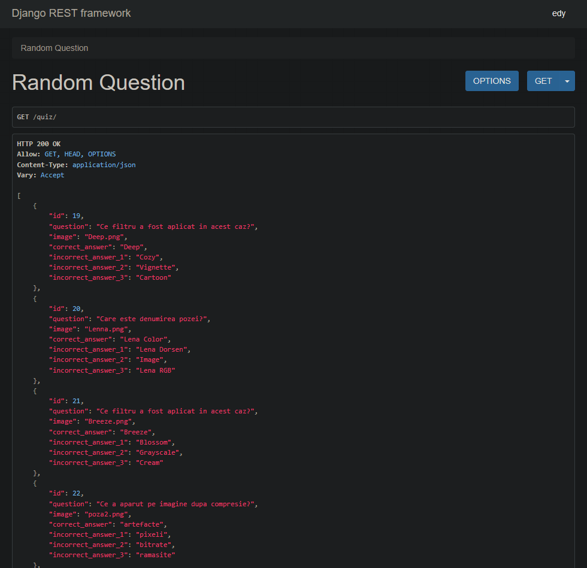
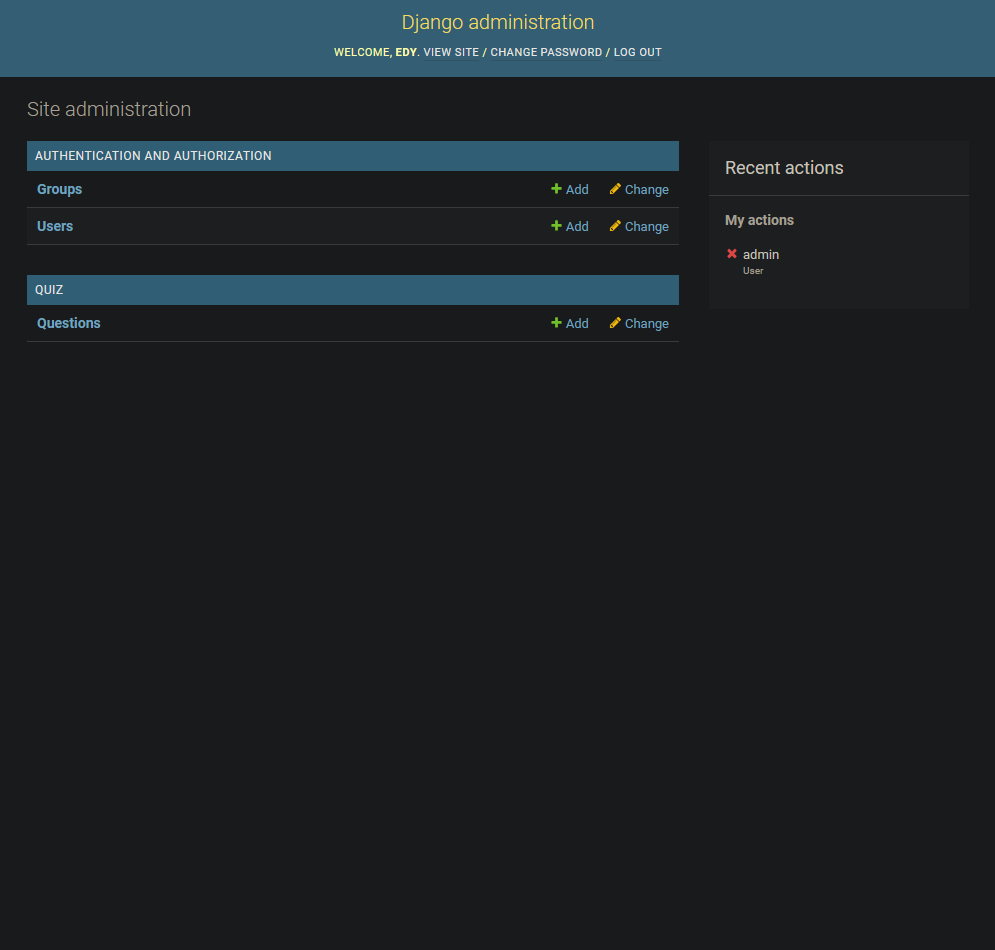

# CookieQuiz Backend

Django REST API backend for the **CookieQuiz** trivia application. It serves quiz questions and associated image assets from `http://127.0.0.1:8000` and enables cross-origin requests for the React frontend.


## Tech Stack

- **Python 3.7.9** (virtual environment in `.venv`)
- **Django 3.2.25**
- **Django REST Framework 3.15.1**
- **django-cors-headers 4.1.0**
- **SQLite** (`db.sqlite3`)


## Project Structure

```text
backend/
├── core/            # Project settings and root URL configuration
├── quiz/            # Quiz models, views, serializers, and endpoints
├── static/          # Static files
├── db.sqlite3       # Local SQLite database
├── manage.py        # Django management script
└── requirements.txt # Python dependencies
```


## Setup and Installation

1. Create and activate a virtual environment:

- Windows (Command Prompt):
```batch
python -m venv .venv
venv\Scripts\activate
```

- Windows (PowerShell):
```powershell
python -m venv .venv
.venv\Scripts\Activate.ps1
```

- macOS / Linux:
```bash
python3 -m venv .venv
source .venv/bin/activate
```

2. Install dependencies:
`pip install -r requirements.txt`

3. Apply database migrations

3.1. Run migrations only if you deleted `db.sqlite3` to start with a fresh database or if new migrations are added:
`python manage.py migrate`

4. (Optional) Create an admin user to access the Django admin panel:
`python manage.py createsuperuser`


## Running the Server

Start the development server:
`python manage.py runserver`
The server runs at http://127.0.0.1:8000


## Available Endpoints

- `GET /quiz/` — Returns a list of quiz questions (id, question, image, correct_answer, incorrect_answer_1, incorrect_answer_2, incorrect_answer_3).
- `GET /images/<path>` — Serves images referenced by the image field on questions.
- `GET /admin/` — Django administration interface.


## CORS Configuration

`django-cors-headers` is configured in `core/settings.py` so the React frontend running locally (such as `http://localhost:3000`) can query `/quiz/` and load images from `/images/`


## Screenshots



