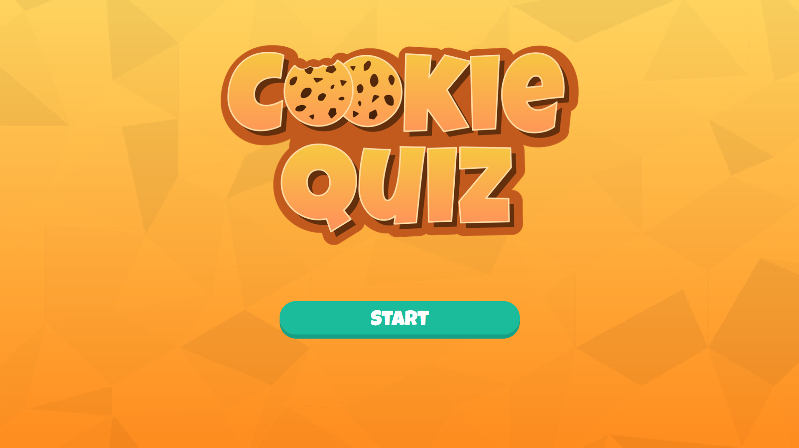
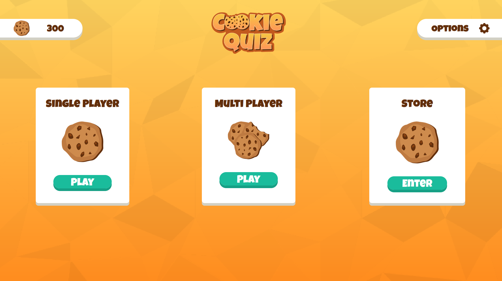
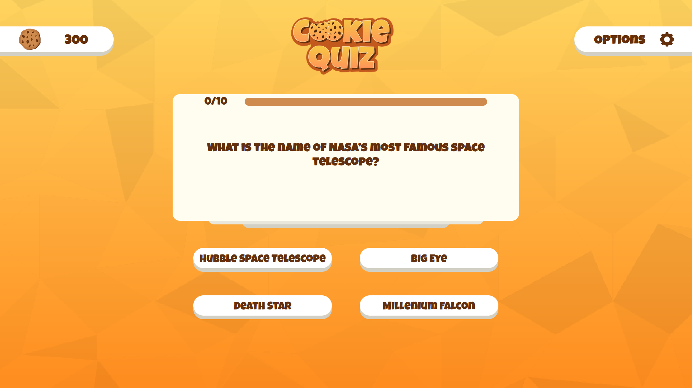

# CookieQuiz

CookieQuiz is a trivia game prototype built with React that fetches random 10-question quizzes across varied topics. Each question offers four answer choices, and the player selects the correct option.

## Prerequisites

- **Node.js**: Tested and working with `v26.13.1`
- **npm**: Tested and working with `11.20.0`

## Installation

Install the dependencies:
`npm install --legacy-peer-deps`

**Note: --legacy-peer-deps is used because package.json includes react-native alongside react 17.0.2, which triggers a peer dependency conflict under standard npm resolution.

## Running the Project

Start the development server:
`npm start`

## Optional

Build the production bundle:
`npm run build`

Run tests:
`npm test`

## Screenshots

